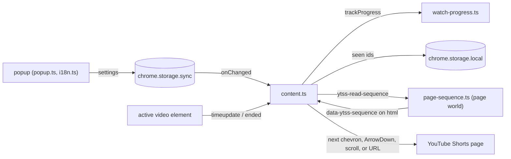

# Architecture: YT Shorts Autoscroll

A Manifest V3 Chrome extension that advances YouTube Shorts when one finishes, remembers which Shorts were watched, and lets the user tune both from a popup. It is a client-side extension only: it has no server and no background service worker, and it sends no data anywhere. README.md covers installing it and what each setting does.

## Why this design

- **Classic scripts, no bundler.** `tsconfig.json` compiles with `"module": "none"`, so each `src/*.ts` becomes one plain script and the manifest lists them in load order. Content scripts share one global scope per world, so `settings.ts` and `watch-progress.ts` expose declarations that `content.ts` uses without imports. This beats a bundler here because the extension has no runtime dependencies, and `tsc` alone produces the shipped files. The cost is that a per-file linter cannot see cross-file use, so `.oxlintrc.json` hands the unused-variable check for `src/` to `tsc`'s `noUnusedLocals`.
- **Polling plus events over a single observer.** YouTube Shorts is a single-page app that swaps `<video>` elements as the user scrolls. `content.ts` re-detects the active video on a 400 ms poll and on YouTube's `yt-navigate-finish` event, so a missed event only delays detection by one poll.
- **Seen means watched through, recorded on leaving.** A Short enters the history when the user moves off it, and only if playback got beyond its first 3 seconds and into its last 3 seconds (the midpoint for a Short under 6 seconds). Marking on arrival would put the Short being watched into the history at once; marking any Short left would also count ones scrolled past unwatched. `src/watch-progress.ts` holds this rule as pure functions, so the unit tests run it without a browser.

## How it works

- `content.ts` runs in the isolated world. It treats a Short as finished on `ended` or on a jump back to the start from near the end, which is how a loop looks from outside. It then advances by clicking YouTube's next chevron, falling back to an `ArrowDown` key event and then to scrolling.
- During playback each `timeupdate` feeds `trackProgress`. When the Short id in the URL changes, `watchedThrough` decides whether the Short being left is written to the seen history, and the progress resets.
- In a hidden tab, if the Short has not changed 2 seconds after an advance, the next Short's URL is loaded directly. The upcoming ids come from `page-sequence.ts`, which runs in the page's own world because YouTube keeps them on a page-side JS property.
- Settings live in `chrome.storage.sync`. The seen history lives in `chrome.storage.local` under `seenShorts`, capped at the newest 2000 ids.

## Operations

- **Configuration and policy:** all settings come from the popup, with defaults in `DEFAULT_SETTINGS` in `src/settings.ts`. Missing keys fall back to those defaults on load.
- **Deployment and scaling:** `npm run build` writes the loadable extension to `dist/`. The release workflow (`.github/workflows/release.yml`) runs semantic-release on `main`.
- **Third-party integrations:** the extension depends on YouTube's markup: `ytd-reel-video-renderer[is-active]`, `#navigation-button-down`, the `yt-navigate-finish` event and the sequence properties on `<ytd-shorts>`. A change to any of them stops detection or advancing until the code follows it; only advancing has fallbacks (key event, then scroll).
- **Verification:** `make verify` runs lint (typecheck, oxlint, locale sync), unit tests for `watch-progress.ts`, and an e2e run. The e2e loads `dist/` into a real Chromium with Playwright and answers `youtube.com` with a stand-in Shorts page through request routing, so the content scripts inject as on the real site. It writes `output/e2e-report.json`. The coverage figure covers the compiled scripts the unit tests load; the e2e covers the rest.

## Security and privacy

- **Attack surface:** content scripts run only on `https://www.youtube.com/*` and `https://m.youtube.com/*`, and the only permission is `storage`. `content.ts` reads the upcoming ids from a page attribute, parses them as JSON inside a `try`, and only uses them to build a `/shorts/<id>` path on the same origin. The extension handles no secrets.
- **Privacy:** the seen history is a list of YouTube video ids stored in the browser's local extension storage on that machine. It is never sent anywhere. Settings sync through the user's Chrome profile. There is no telemetry and no other personal data.
